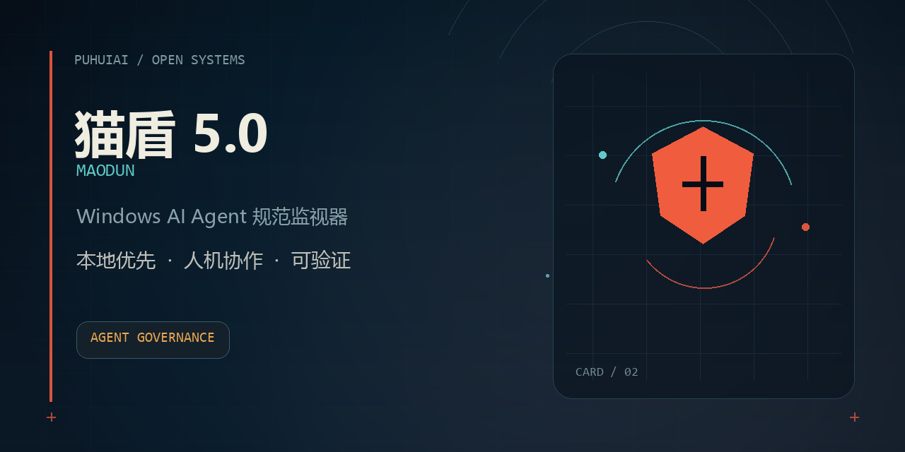

# 猫盾 Maodun 5.0：Windows AI Agent 规范监视器

猫盾是一款面向 Windows 的 AI Agent 规范监视器。它帮助发现本机运行的 AI Agent、工作流与知识库，记录行为、管理授权，并对高风险操作执行分级处置。软件免费使用，闭源发布。

## 下载

- [下载猫盾 5.0 安装包](https://github.com/puhuiai/maodun/releases/download/v5.0.0/Maodun5.0_Setup.exe)
- [查看全部 Releases](https://github.com/puhuiai/maodun/releases)
- [产品中心](https://puhuiai.github.io/website/#maodun)

## 核心能力

- 自主发现本机 AI Agent、工作流和知识库
- 监控运行行为并记录关键事件
- 按时间、目录和权限范围进行授权
- 高风险操作二次确认
- AI 发起的删除与覆盖操作需要人工确认
- 不修改目标智能体源码

## 安装

1. 下载 `Maodun5.0_Setup.exe`
2. 双击安装，如被安全软件拦截请核验文件来源后加入信任
3. 首次启动时配置监控目录与授权范围

## 适用场景

- 本机 AI Agent 行为审计
- 自动化工作流权限管理
- 知识库与本地文件操作监控
- 企业内个人开发机的 AI 工具治理

## 边界

猫盾是 AI Agent 规范监视器，不是杀毒软件，不替代终端安全软件。

## 反馈

问题、建议或误报请提交 [Issues](https://github.com/puhuiai/maodun/issues/new/choose)，并附 Windows 版本、猫盾版本、复现步骤和截图。

## 授权

猫盾免费使用，闭源发布。禁止反编译、二次打包和商业转售。

Built by 汪君 · 普惠AI
